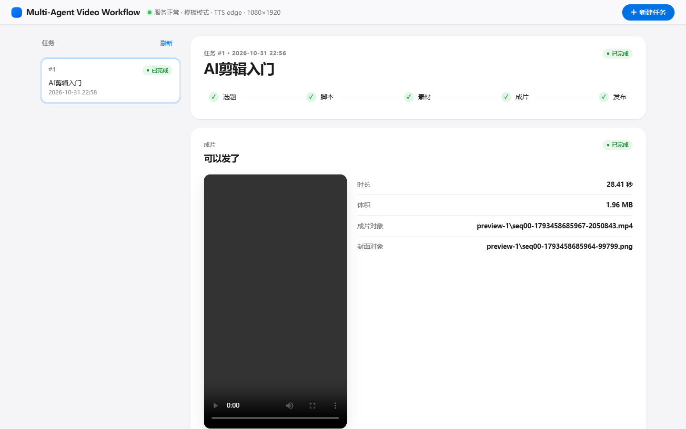

# Multi-agent-video-workflow

把「内容生成 → 成品渲染 → 发布」做成一条**可以随时停下来改、改完接着跑**的自媒体流水线。

它融合了两个项目的长处：

| 来源 | 拿走了什么 |
| --- | --- |
| yq-admin 的 `aimedia` 模块 | 业务字段与状态语义（选题/素材/审核/成品任务、"生成链路"的分段方式） |
| YanQue-AI（LangGraph 内容生成） | 编排骨架：人工确认、打回重做、改稿、断点续跑 |
| Multi-Agent-Video-Creation（MoneyPrinterTurbo 系） | 渲染能力：TTS 配音 + 逐词时间轴、字幕烧录、镜头动效、ffmpeg 合成、BGM 混音 |

一句话区别：**MPT 选定参数后只能一口气跑完；本项目每一步产出后都停在 GATE 上等你点头、等你改、或者等你打回。**

## 快速开始

```powershell
cd D:\AGI\Multi-agent-video-workflow
python -m venv .venv
.\.venv\Scripts\python.exe -m pip install fastapi "uvicorn[standard]" httpx pydantic pillow edge-tts imageio-ffmpeg python-dotenv

# 全自动出一条片（不依赖 MySQL / TOS / Java）
.\.venv\Scripts\python.exe scripts\demo.py --brief "AI剪辑入门" --auto

# 交互式：每个 GATE 停下来等你确认/打回
.\.venv\Scripts\python.exe scripts\demo.py --brief "AI剪辑入门"

# 从中断处继续（进程重启也没关系，状态在 output/pipeline.db）
.\.venv\Scripts\python.exe scripts\demo.py --task-id 1 --auto

# 起服务（HTTP 接口 + Java 对接入口）
.\.venv\Scripts\python.exe scripts\serve.py --port 8010
```

产物：

```
output/pipeline.db                       任务/步骤/GATE 决策/产物 全部落库
output/assets/materials/task-<id>/*.png  素材（无现成配图时用 Pillow 生成的占位卡）
output/assets/preview-<id>/*.mp4|*.png   成片与封面
output/publish/publish-<id>-*.json       发布单（标题/文案/标签/成片路径）
```

## 五个步骤，四个 GATE

| 步骤 | 产出 | 停下来等你做什么 |
| --- | --- | --- |
| TOPIC | 3 条选题候选 | 选哪一条 / 自己改方向 |
| SCRIPT | 分镜口播稿 + 标题/文案/标签 | 改稿、增减镜头、打回重写 |
| MATERIAL | 每个镜头的配图（本地素材库或占位卡） | 换图、删镜头、打回重配 |
| RENDER | 1080x1920 MP4（配音+字幕+镜头动效） | 审片，不满意打回（后续步骤产物自动失效） |
| PUBLISH | 发布单 JSON（可选 webhook 推送） | 收尾 |

决策只有三种：`approve`（通过）/ `edit`（带着修改再跑一遍）/ `reject`（打回重做并作废下游产物）。

## 前端工作台（web/）

起服务后直接打开 <http://127.0.0.1:8010/>，就是一个 Apple 风格的单页工作台：左边任务列表，右边步骤进度 + 当前步骤产出 + GATE 操作条。



能力：

- 新建任务：一句话简报 → 自动选题
- 选题：三张卡片点选，再按「通过」
- 脚本：标题 / 封面标题 / 文案 / 标签 / 每个镜头的大字与口播都能直接改
- 素材：看缩略图，把 `image_path` 换成自己的图片路径即用真图
- 成片：内置播放器，直接看 1080×1920 的 MP4
- 发布：标题、文案、标签、平台与发布单
- 三种决策：通过 / 带着修改重跑 / 打回重做

技术上刻意保持零构建：`web/` 下只有 `index.html`、`app.css`、`app.js` 三个文件，由 FastAPI 用 `StaticFiles` 挂在根路径；接口全部复用 `/api/*`，没有额外依赖，也没有打包步骤。后端只多了两个只读路由：素材原图 `/api/tasks/{id}/materials/{index}` 与产物本体 `/api/tasks/{id}/artifacts/{aid}`（都只放行数据库里登记过的路径）。

## 目录里的 Java 代码是什么

`java/aimedia-module/` 是从 yq-admin 原样复制过来的 `com.yanque.aimedia` 包（187 个文件中占 133 个 java/xml），**不是本服务的运行时**，作用是字段与状态语义的对照物：枚举、实体、Mapper、Handler、Controller 都保持你原来的样子，方便以后并回 yq-admin 时逐项对齐。

真正跑起来的是 `src/mavw`（Python）。两者没有代码级耦合，唯一契约是 `/ai/content-generation/topics/previews/render` 这个同名同形的接口。

## 配置

全部走环境变量，见 [.env.example](.env.example)。默认值是「离线也能出片」：

- 没有大模型 key → 用内置模板生成选题与口播稿；
- 没有配图 → 用 Pillow 生成竖屏素材卡；
- 没有 ffmpeg → 用 `imageio-ffmpeg` 自带二进制；
- 配音默认 `edge-tts`（免费，无需 key，带逐词时间轴）；
- 存储默认落本地，`STORAGE_BACKEND=presign` 才回 yq-admin 取 TOS 预签名。

## 和 Java（yq-admin）对接

服务暴露了与 yq-admin `ContentGenerationPythonClient.renderPreview` **同名同形**的路径：

```
POST /ai/content-generation/topics/previews/render
{ "preview_task_id": 123, "format": "VIDEO", "cover_title": "...",
  "publish_caption": "...", "tags": ["..."],
  "items": [{ "need_id": "N01", "asset_type": "GENERATED_IMAGE", "source_url": "https://...",
              "headline": "...", "body": "...", "duration_ms": 7000 }] }
→ { "format": "VIDEO", "cover_object_key": "...", "cover_file_size": 0,
    "video_object_key": "...", "video_file_size": 0, "duration_ms": 32490, "items": [] }
```

把 yq-admin 的 `yanque-ai.base-url` 指到本项目端口，并配上 `STROAGE_BACKEND=presign` 与
`YANQUE_INTERNAL_API_KEY`，即可由 Java 侧发起渲染、拿回 object key 落库。

## 已验证

- `scripts/demo.py --brief "AI剪辑入门" --auto`：5 步全绿，产出 1080x1920 / 30fps / h264 + aac / 28.41s 的成片，镜间静音 0 处 ≥0.5s；
- `scripts/smoke_gates.py`：选题确认、脚本打回重跑、改稿保留、进程重启续跑、下游失效重置，6 条断言全通过；
- 坐标自测：抽取第 8 秒画面确认「卡片标题 + 底部标签 + 字幕」三层不重叠。

## 目录

```
src/mavw/
  config.py            全部开关（30+ 项，命名与 YanQue-AI 对齐）
  storage.py           本地存储 / TOS 预签名存储
  llm.py               选题与脚本（大模型 + 内置模板兜底）
  render/              成片渲染：tts / subtitle / compose / ffmpeg_tools / card(PIL) / renderer
  pipeline/            步骤定义与可中断状态机（sqlite 落库）
  publish/             发布适配（dry-run 发布单 / webhook）
  api.py, main.py      FastAPI 接口层
java-module/           从 yq-admin 复制过来的 aimedia 包（字段与枚举参照）
reference/mpt/         渲染层原始参考实现（voice/video/subtitle/bgm/material/task）
sql/schema.sql         管线库可读快照
docs/ARCHITECTURE.md   融合映射与扩展点
```

## 在这台机器上提交（Git 补丁说明）

本机 `D:\Git\Git` 只带了 `git-remote-ftp`，缺 `git-remote-http/https`，任何 `git clone/push` 都会报
`git: 'remote-https' is not a git command`。winget 升级失败是因为 DSH 自身的 bash.exe 正占用该目录。

绕过方式：用便携版 MinGit 2.56 + 一个包装脚本。

```powershell
# 已就绪：D:\AGI\tools\MinGit（2.56.0.4）+ D:\AGI\tools\git-gh.cmd
# 以后在这个仓库里，把 git 换成 git-gh 即可
cmd /c "D:\AGI\tools\git-gh.cmd" status
cmd /c "D:\AGI\tools\git-gh.cmd" push origin main:feat/Multi-agent-video-workflow
```

包装脚本里有三件必须的事：`GIT_SSL_CAINFO` 指向 MinGit 自带证书（否则报
`error adding trust anchors from C:/Program Files/Git/.../ca-bundle.crt`）、`GIT_EXEC_PATH` 指向
ucrt64 的 git-core、以及调用 `D:\AGI\tools\MinGit\cmd\git.exe`。

## 边界

- 发布只到「发布单」：抖音/小红书真实上传要 Cookie 与分片上传，扩展点已留在 `publish/adapters.py`；
- 素材来源默认占位卡；把 `PIPELINE_MATERIAL_DIR` 指向你的 AI 出图目录即可换成真图；
- 素材库/图片生成的在线供应商（pexels、seedance 等）未接入，接口位置在 `pipeline/service.py` 的 `_step_material`。
